# CYSE 211 — Lab 3: USB Partitioning & Filesystem Management

  

Documented a hands-on Linux storage lab using a **USB flash drive** attached to Ubuntu. The exercise covers recognizing the disk, inspecting and editing partitions with `fdisk`, creating an **ext4 filesystem**, mounting and inspecting filesystem metadata, safely unmounting, and initiating a **VFAT/FAT32 reformat**.

**Lab report:** [View the original 9-page PDF](docs/CYSE211_Lab3_Report.pdf)

## At a glance

| Item | Details |
|---|---|
| Assessment focus | Linux partitioning, formatting, mounting and filesystem inspection |
| Environment | Ubuntu Linux and a removable USB flash drive |
| Disk | `/dev/sda` (238 GiB shown by `fdisk`) |
| Utilities | `dmesg`, `umount`, `fdisk`, `mkfs`, `mount`, `ls` and `dumpe2fs` |
| Filesystems | exFAT (initial signature), ext4 (created), VFAT (format command invoked) |
| Evidence | 14 screenshots embedded below and the original 9-page lab PDF |

## Assessment Workflow

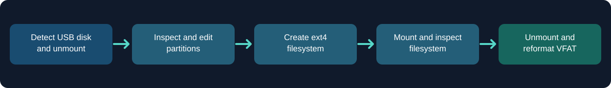

## Evidence Screenshots

All **14 screenshots** are embedded directly in the README, in lab report order.

### 01. USB device detection

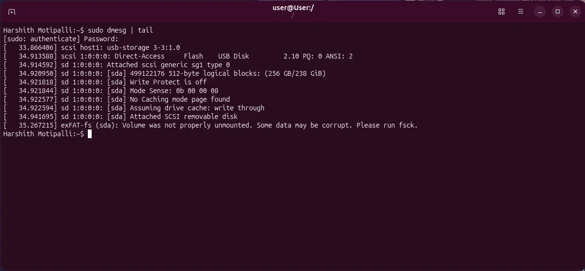

*The kernel messages identify the USB storage device as /dev/sda and warn that its exFAT volume was not properly unmounted.*

### 02. Verify device is unmounted

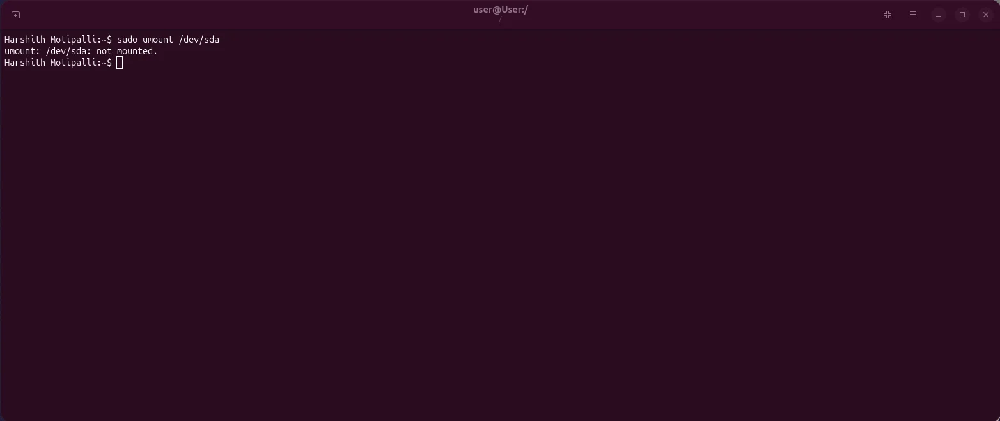

*The attempted unmount returned a not-mounted message for /dev/sda.*

### 03. Inspect the existing partition table

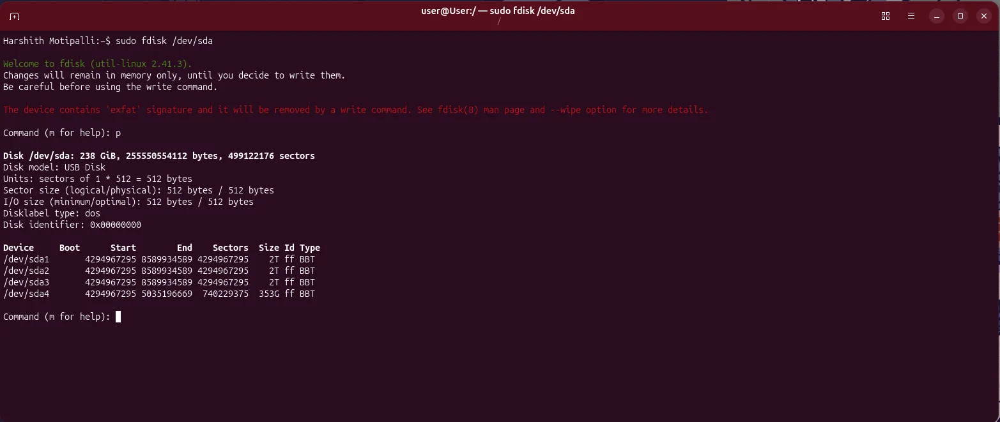

*Opened fdisk on /dev/sda and printed the original partition table.*

### 04. Delete selected partition entries

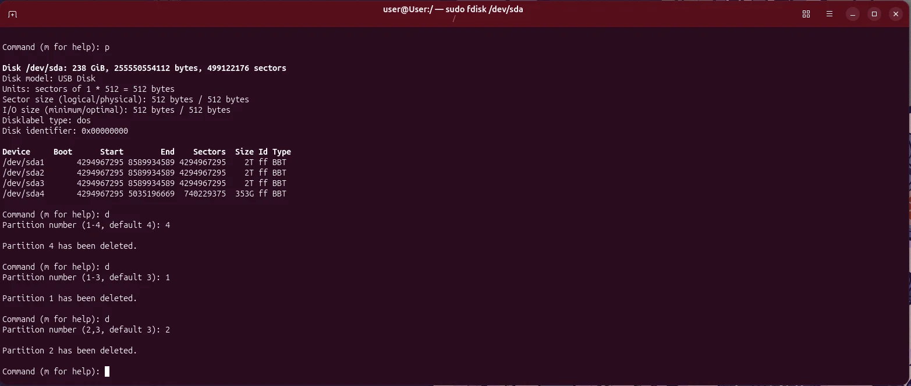

*Used fdisk to delete entries for partitions 4, 1 and 2 before creating a new layout.*

### 05. Create a primary partition

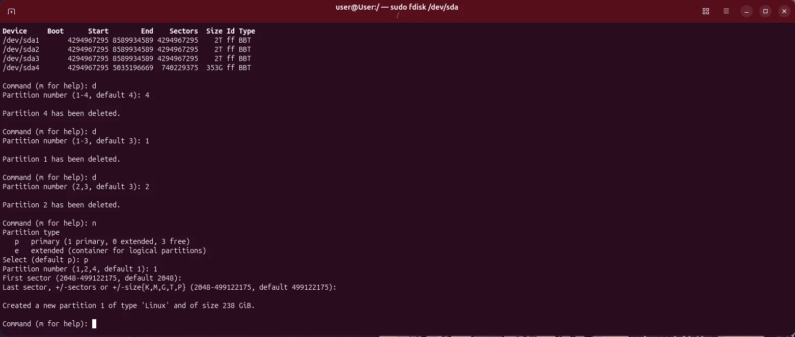

*Created a Linux primary partition using the default sector range.*

### 06. Write partition changes

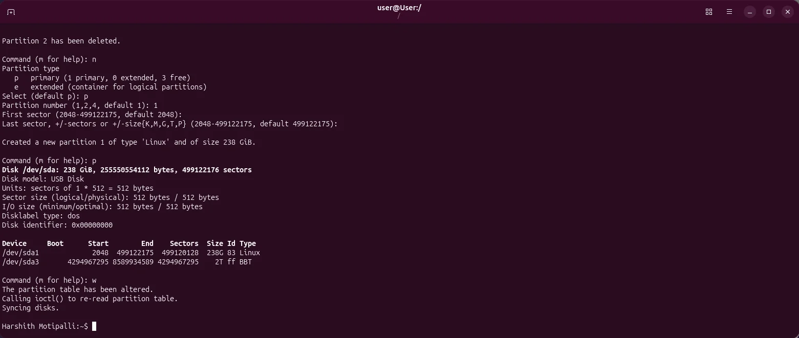

*Wrote the changes with fdisk and triggered a partition-table re-read.*

### 07. Inspect the updated layout

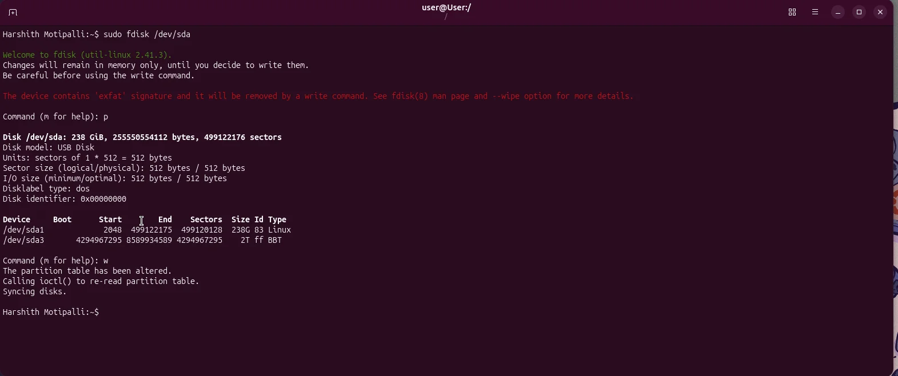

*The new /dev/sda1 Linux partition is visible alongside a residual /dev/sda3 entry.*

### 08. Format the partition as ext4

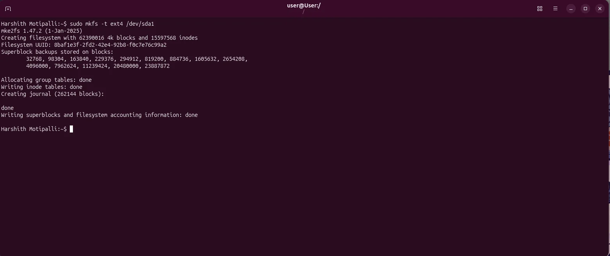

*The mkfs command reports allocation of filesystem metadata and journal creation.*

### 09. Create the mount directory

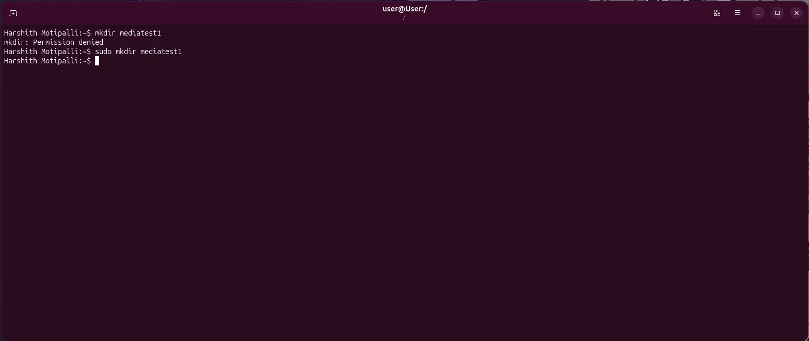

*The first mkdir failed due to permissions; using sudo created mediatest1.*

### 10. Mount the ext4 partition

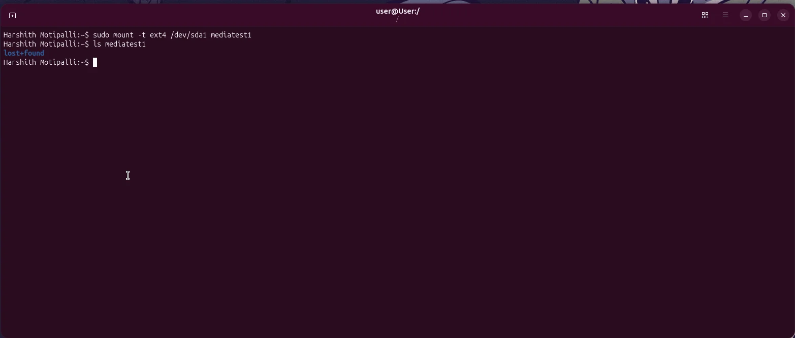

*Mounted /dev/sda1 into mediatest1 and listed the lost+found directory.*

### 11. Inspect ext4 metadata

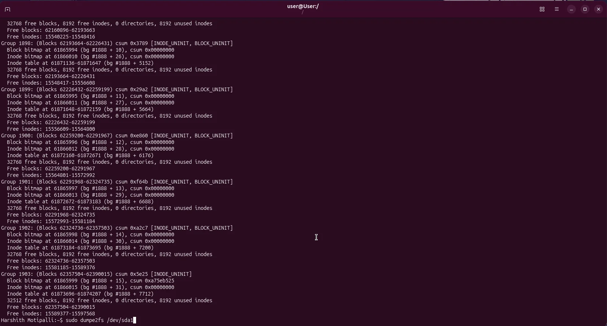

*Used dumpe2fs to inspect block groups, inode data and filesystem metadata.*

### 12. Review filesystem features

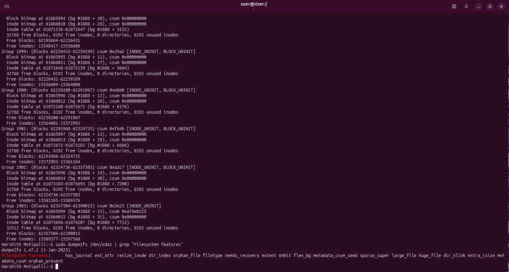

*Filtered dumpe2fs for filesystem feature flags including has_journal, extent and 64bit.*

### 13. Unmount the partition

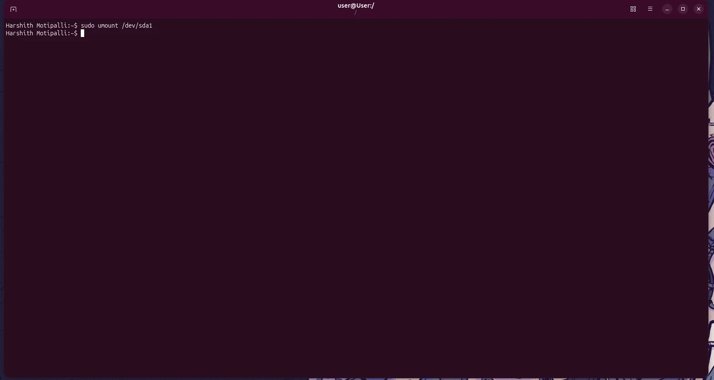

*Unmounted /dev/sda1 prior to another format operation.*

### 14. Start VFAT formatting

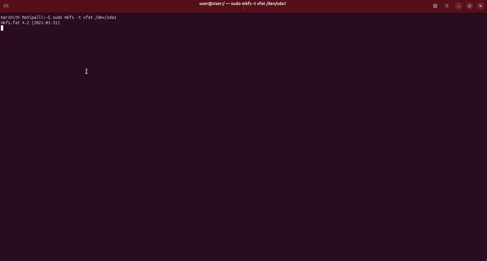

*Invoked mkfs for VFAT; the screenshot shows the utility starting, not a separate verification of the final filesystem.*

## Findings and Evidence

| Finding | Evidence and observation |
|---|---|
| USB recognition | Kernel messages identified `/dev/sda` and flagged an improperly unmounted exFAT volume. |
| Partition configuration | `fdisk` showed changes to the partition table and creation of `/dev/sda1`. A residual `/dev/sda3` entry was still present; therefore a fully cleared disk is not established by these screenshots. |
| ext4 creation | The format command created ext4 filesystem structures, including a journal. |
| Mount and inspection | Listing the mounted directory showed `lost+found`, and `dumpe2fs` displayed ext4 filesystem metadata and supported features. |
| VFAT operation | The VFAT formatting command was initiated; a subsequent post-format check is not included in the screenshots. |

## What This Project Demonstrates

- Linux block-device discovery and identification.
- Partition-table inspection and modification using `fdisk`.
- Formatting and mounting an ext4 filesystem.
- Inspecting on-disk filesystem structures with `dumpe2fs`.
- Unmounting storage and working with ext4 and VFAT formatting tools.
- Documenting system output while distinguishing observed results from unverified outcomes.
